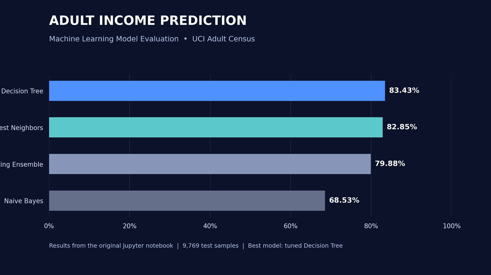

<div align="center">

# 🧠 Predicting Adult Income Using Census Data

### An End-to-End Machine Learning & Data Mining Project

   

**Predicting whether annual income exceeds $50,000 using demographic and employment data from the UCI Adult Census dataset.**

</div>

## 📊 Model Performance



| Model | Test accuracy |
|---|---:|
| **Decision Tree (cross-validation tuned)** | **83.43%** |
| K-Nearest Neighbors (cross-validation tuned) | 82.85% |
| Soft Voting Ensemble | 79.88% |
| Naive Bayes (reduced features) | 68.53% |

These values come from the final comparison in the included notebook; the written report and slides round the top two scores to **83.4%** and **82.8%**. Earlier baseline experiments in the notebook have different results.

## 🎯 Project Overview

The project explores a binary income-classification problem using **48,842 census records** and a complete workflow spanning exploratory data analysis, cleaning, feature engineering, feature selection, classification, hyperparameter tuning, and evaluation. The dataset has a class imbalance: roughly 24% of observations belong to the `>50K` category.

## 🔬 Methodology

1. **Explore and clean:** inspect missing values, categorical inconsistencies, outliers, and skewed variables; remove the redundant `education` field and the census sampling weight `fnlwgt`.
2. **Engineer features:** cap selected outliers; create age groups, long-working-hours and capital gain/loss indicators; encode categorical variables and scale continuous features.
3. **Select features:** compare mutual-information scores and model-based feature importance, then evaluate a reduced set of **21 features**.
4. **Train and tune:** compare KNN, Decision Tree, and Gaussian Naive Bayes; tune KNN and Decision Tree using `GridSearchCV` with stratified five-fold cross-validation.
5. **Evaluate:** examine accuracy, classification reports, confusion matrices, feature importance, and a soft-voting ensemble.

**Best Decision Tree parameters (notebook):** `criterion='entropy'`, `max_depth=9`, `min_samples_leaf=10`, `min_samples_split=2`.

**Best KNN parameters (notebook):** `n_neighbors=11`, `p=2`, `weights='uniform'`.

## 💡 Key Findings

- The tuned Decision Tree performed best on the held-out test set.
- Marital status, education, age, hours worked, occupation, and household relationships emerged as informative features.
- The soft-voting ensemble did not improve accuracy over the best individual model.
- Accuracy alone should be interpreted cautiously because the income classes are imbalanced.

## 📂 Repository Structure

```text
adult-income-prediction/
├── Adult_Income_Prediction.ipynb
├── adultAll.csv
├── assets/
│   └── model_comparison.png
├── docs/
│   ├── Final_Project_Report.pdf
│   └── Project_Presentation.pdf
├── requirements.txt
├── .gitignore
└── README.md
```

## ▶️ Run the Notebook

```bash
git clone https://github.com/khaydieramos/adult-income-prediction.git
cd adult-income-prediction
python3 -m venv .venv
source .venv/bin/activate
python -m pip install -r requirements.txt
jupyter notebook Adult_Income_Prediction.ipynb
```

The **48,842-row dataset is included locally as `adultAll.csv`**. The notebook's data-loading cell has been updated to use `pd.read_csv("adultAll.csv")`, so no external dataset download is required. The remaining notebook cells are preserved from the submitted project. Run cells in order; results may depend on installed package versions. This is a research notebook, not an automated production pipeline.

## ⚠️ Limitations & Future Work

The dataset is imbalanced and contains sensitive demographic variables, so prediction quality across subgroups and fairness require further study before any real-world use. Additional improvements could include leakage-safe preprocessing and feature selection inside cross-validation pipelines, stratified evaluation, Random Forest or gradient boosting models, and class-imbalance techniques. **This is an academic exploration, not a tool for making decisions about individuals.**

## 📚 Project Materials

- [Jupyter Notebook (local CSV path)](Adult_Income_Prediction.ipynb)
- [Adult Census Dataset CSV](adultAll.csv)
- [Final Project Report](docs/Final_Project_Report.pdf)
- [Presentation Slides](docs/Project_Presentation.pdf)

---

**Author:** [Khaydie Ramos](https://github.com/khaydieramos) · Fordham University · Data Mining Final Project
